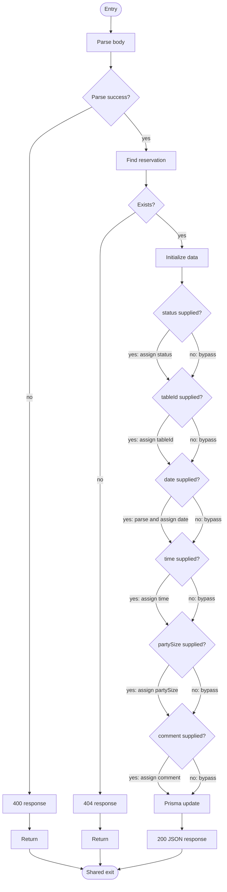

# Static, Coverage, and Mutation Report

## Toolchain

- Node `v24.15.0`, npm `11.12.1` locally. CI currently selects Node 22.
- TypeScript `^5.7.0`, Express `^4.21.0`, Prisma/client `^5.22.0`, Vitest `4.0.18`, Playwright `1.58.2` resolved from the project manifests/lockfile.
- Added exact `@vitest/coverage-v8 4.0.18`, `@stryker-mutator/core 9.1.1`, and `@stryker-mutator/vitest-runner 9.1.1`.

## Manual CFG: `updateReservation`

Each optional decision has a true edge labeled with its assignment and a false edge labeled as a bypass; both join at the next decision. The two early error paths each show a response node and a return node before joining the single exit. The verified graph has 19 nodes and 26 edges, one connected component, so `V(G) = E - N + 2 = 26 - 19 + 2 = 9`. This matches the eight explicit decisions (parse success, reservation existence, and six supplied-field checks) plus one formula baseline: `8 + 1 = 9`. It must not be described as nine independent decisions. Promise rejection, Prisma exceptions, `new Date` behavior, Express failures, and Zod internals are implicit exceptions omitted from the graph.

No function-level analyzer value is available yet. A whole-file Sonar complexity value must not be compared to 9.

## Coverage run

Command: `npm run coverage:member1`

- Test result: 50 passed, 0 failed.
- Full selected-controller denominator: 100% statements, 100% branches, 100% functions, 100% lines.
- Gate: passed. The assignment target of 100% statements and branches is met.
- Uncovered code: none in the declared reservation/table controller denominator.
- Release effect: the white-box coverage criterion passes; mutation, Sonar, and CI criteria remain independent blockers.
- LCOV: `packages/server/coverage/member-1/lcov.info`.

## Mutation baseline

Command: `npm run mutation:member1`; duration 43 seconds; targets were exactly the reservation and table controllers; 20 Member 1 tests executed.

| Metric | All | Reservation | Table |
|---|---:|---:|---:|
| Mutants | 556 | 429 | 127 |
| Killed | 152 | 118 | 34 |
| Survived | 117 | 88 | 29 |
| No coverage | 286 | 222 | 64 |
| Timed out | 1 | 1 | 0 |
| Tool errors | 0 | 0 | 0 |
| Overall mutation score | 27.52% | 27.74% | 26.77% |
| Covered mutation score | 56.67% | 57.49% | 53.97% |

The overall denominator includes no-coverage mutants; the covered score excludes them. The run failed the configured 60% breaking threshold. Raw machine-readable results are in `reports/mutation/member-1/mutation.json`; the HTML report is `reports/mutation/member-1/index.html`.

The baseline report is preserved unchanged to maintain chronology; later runs use distinct output directories.

The expanded 56-test run first scored 53.78% (298 killed, 257 survived, no no-coverage mutants, one timeout). Exact response and dependency-call assertions raised the historical final result to 63.31% (351 killed, 204 survived, no no-coverage mutants, one timeout). The follow-up rerun with one added exact table-location oracle has 57 tests and scored 65.47% (363 killed, 192 survived, no no-coverage mutants, one timeout), passing the unchanged 60% break threshold. Fifteen genuine survivors and their matched outcomes are documented in `mutation-analysis.md`; mutants 434 and 435 are now killed, and both deterministic custom operators remain killed.

## SonarQube Cloud PR analysis

PR #1 was analyzed by workflow run `44894584324` at SHA `f51b0c7c63ead6740d6de8b47024093df4f5b86f`, against base SHA `d6af7237e9569ebeab19ccab375362f9d144e25e`. The coverage artifact downloaded successfully, the `lcov.info` pre-scan check passed, and SonarQube Cloud uploaded and processed the analysis. The scanner then exited with code 3 because the quality gate failed; this was not a scanner startup or token/organization configuration error.

| Quality gate condition | Actual | Required | Result |
|---|---:|---:|---|
| New reliability rating | C | A | Fail |
| New security rating | C | A | Fail |
| New-code coverage | 0.0% on 94 new lines to cover | At least 80.0% | Fail |
| New duplicated lines | 79.0% (79.03% in the UI) | At most 3.0% | Fail |

The historical PR #1 summary reported 19 new issues. The coverage upload/import completed; Sonar's new-code scope counted 94 lines under `e2e`, which are not covered by the imported controller LCOV file. This is distinct from the Member 1 controller coverage result above (100% statements and branches). The high duplication and C reliability/security ratings are actual failures for PR #1, not treated as passing.

At the time of PR #1, the SonarQube Cloud Overview showed **`'main' branch has not been analyzed yet.`** No scanner error said PR analysis was impossible; that analysis completed. The later reviewed merge established the main baseline: Member 1 run `45004176915` passed at `00f0449039601f0a5de1fd39e4d3365e9bbc0b77`. No direct push to main was performed.

Screenshots for the Overview, PR new-code coverage, quality gate, and Actions Sonar job are saved in `screenshots/sonar-overview.png`, `screenshots/sonar-coverage.png`, `screenshots/sonar-quality-gate.png`, and `screenshots/actions-sonar-job.png`. They document analyzed SHA `f51b0c7c63ead6740d6de8b47024093df4f5b86f`.

The earlier local Docker/SonarQube attempts remain historical evidence only: Docker Desktop reached a read-only metadata failure before a local scan. They are superseded by this completed Cloud analysis.

## Historical repository E2E check failure (PR #1)

The repository's separate PR #1 E2E job failed before running tests with the exact error `Playwright does not support chromium on ubuntu26.04-x64`. This historical runner/toolchain failure is distinct from PR #8, whose E2E job passed at application-code head `03d977cf352699dbfca919c4209056c1116e3818`.

## Past-date reservation fail-to-pass PR

The API contract in `packages/docs/api/reservations.md` specifies `400 Cannot reserve in the past`. At main commit `00f0449039601f0a5de1fd39e4d3365e9bbc0b77`, `createReservation` checked the date's shape but did not reject a date earlier than today. The storefront's `min` attribute did not protect direct API requests.

PR #8 was created from current main with two commits kept in order:

| Phase | Commit | Evidence |
|---|---|---|
| Red regression test only | `d405f8326be9d8e2db29f60ff7005e4863b46eef` | [Member 1 run 45007936801](https://github.com/fizzaniaz17-arch/kitchen-nasty/actions/runs/45007936801); [failing coverage job](https://github.com/fizzaniaz17-arch/kitchen-nasty/actions/runs/45007936801/job/137163603085). The test expected status 400 and `{ success: false, error: 'Cannot reserve in the past' }`, but received `Location not found or inactive`; 58 tests passed and 1 failed. |
| Production fix | `80f720cc750accccb0e46004dbe8fe3d8e67928c` | Added a date comparison before database access and returned the documented 400 response. Local Member 1 tests: 59/59 passed; coverage: 100% statements, branches, functions, and lines; mutation: 64.78% (365 killed, 199 survived, no no-coverage mutants, 1 timeout), above the unchanged 60% threshold. |
| Integration fixture correction | `03d977cf352699dbfca919c4209056c1116e3818` | The first repository CI run on the production-fix commit exposed an existing integration fixture hard-coded to `2026-03-15`, now in the past. The fixture was changed to a date one day ahead. The exact CI integration command then passed 337/337 tests locally. |

At PR #8 application-code head `03d977cf352699dbfca919c4209056c1116e3818`, [Member 1 run 45008817893](https://github.com/fizzaniaz17-arch/kitchen-nasty/actions/runs/45008817893) passed coverage, mutation, custom mutations, Sonar Quality Gate, and `Member 1 / Required`. [Repository CI run 45008817912](https://github.com/fizzaniaz17-arch/kitchen-nasty/actions/runs/45008817912) passed unit, integration, E2E, security audit, lint, and build jobs; Mobile Builds also passed. Documentation and evidence were added in commit `1c56e714d3fd9f3f0e3d81ca469492713a54acdd`; its [Member 1 run 45010371565](https://github.com/fizzaniaz17-arch/kitchen-nasty/actions/runs/45010371565), [repository CI run 45010371559](https://github.com/fizzaniaz17-arch/kitchen-nasty/actions/runs/45010371559), and [Mobile Builds run 45010371570](https://github.com/fizzaniaz17-arch/kitchen-nasty/actions/runs/45010371570) also passed. PR #8 remains open and unmerged, and no push was made to `main`.

The final local logs are preserved in `evidence/past-date-fixed-tests.txt`, `evidence/past-date-fixed-coverage.txt`, and `evidence/past-date-fixed-mutation.txt`. Browser captures of the red and green Member 1 run summaries are in `screenshots/pr8-member1-red-d405f83.png` and `screenshots/pr8-member1-green-03d977c.png`.

## Current main and intentional blocked demo

The current `main` SHA remains `00f0449039601f0a5de1fd39e4d3365e9bbc0b77`; its post-merge Member 1 workflow passed at run `45004176915`. PR #6 remains open, targets `main`, and is unmerged. Its latest verified head is `1eedc87cd139459b0f053e47d72bddc1f5de2e6c`; the intentional party-size regression failed the required gate in run `45007186708`, and Sonar was skipped because coverage failed. The supplied authentic merge-box and failed-run captures are preserved in `screenshots/Screenshot 2026-11-22 141015.png` and `screenshots/Screenshot 2026-11-22 141104.png`. PR #6 was not changed.

The manual `updateReservation` complexity remains `V(G)=9` (`E=26`, `N=19`, `P=1`, eight explicit decisions plus one). Its function-level Sonar measurement is still pending; neither the controller total nor a different function's metric is substituted.
