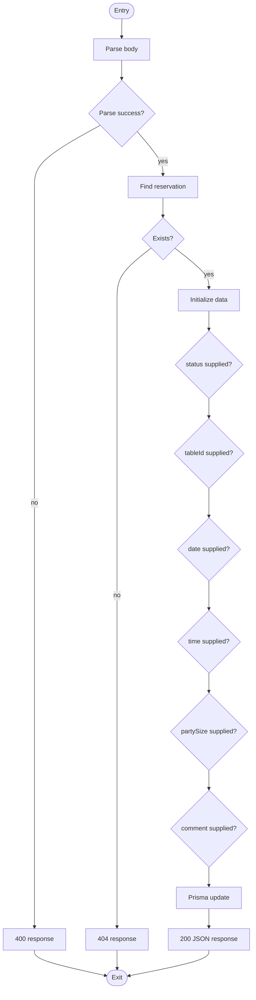

# Static, Coverage, and Mutation Report

## Toolchain

- Node `v24.15.0`, npm `11.12.1` locally. CI currently selects Node 22.
- TypeScript `^5.7.0`, Express `^4.21.0`, Prisma/client `^5.22.0`, Vitest `4.0.18`, Playwright `1.58.2` resolved from the project manifests/lockfile.
- Added exact `@vitest/coverage-v8 4.0.18`, `@stryker-mutator/core 9.1.1`, and `@stryker-mutator/vitest-runner 9.1.1`.

## Manual CFG: `updateReservation`

Each optional decision has a true assignment edge and a false bypass edge before joining the next decision. With those assignment nodes expanded, the verified graph has 19 nodes and 26 edges, one connected component, so `V(G) = E - N + 2 = 26 - 19 + 2 = 9`. This matches the nine independent decisions: parse success, existence, and six optional fields plus the entry-to-shared-exit structure represented by the formula. Promise rejection, Prisma exceptions, `new Date` behavior, Express failures, and Zod internals are implicit exceptions omitted from the graph.

No function-level analyzer value is available yet. A whole-file Sonar complexity value must not be compared to 9.

## Coverage run

Command: `npm run coverage:member1`

- Test result: 20 passed, 0 failed.
- Full selected-controller denominator: 50.78% statements, 46.46% branches, 39.13% functions, 50.00% lines.
- Gate: failed against the configured 80% interim threshold. The assignment target remains 100% statements and branches.
- Main uncovered areas: reservation listing/get/delete/customer-list/analytics and table list/get plus several create/update/delete exception branches.
- Release effect: not ready. The report is deliberately not narrowed to already-tested lines.
- LCOV: `packages/server/coverage/member-1/lcov.info`.

## Mutation baseline

Command: `npm run mutation:member1`; duration 43 seconds; targets were exactly the reservation and table controllers; 20 Member 1 tests executed.

| Metric | All | Reservation | Table |
|---|---:|---:|---:|
| Mutants | 556 | 429 | 127 |
| Killed | 152 | 118 | 34 |
| Survived | 117 | 88 | 29 |
| No coverage | 286 | 222 | 64 |
| Timed out | 1 | 1 | 0 |
| Tool errors | 0 | 0 | 0 |
| Overall mutation score | 27.52% | 27.74% | 26.77% |
| Covered mutation score | 56.67% | 57.49% | 53.97% |

The overall denominator includes no-coverage mutants; the covered score excludes them. The run failed the configured 60% breaking threshold. Raw machine-readable results are in `reports/mutation/member-1/mutation.json`; the HTML report is `reports/mutation/member-1/index.html`.

At least 15 genuine survivors are present for later classification. Examples include response payload removal/boolean flips, omitted Prisma `where` clauses, forced conditions, and the table `isActive` default flip. Classification and survivor-driven tests are pending; preserving this report maintains baseline chronology.

## SonarQube blocker

`docker version` found Docker Desktop client `29.5.3`, but the `desktop-linux` engine pipe did not exist on 2026-11-21. Therefore no local SonarQube service, health check, scan, background task, metrics, ratings, or screenshots could be produced. `sonar-project.properties` defines production/test scope and imports the exact Member 1 LCOV path. Start Docker Desktop, then provision a pinned Community Build and supply the token privately before scanning.
