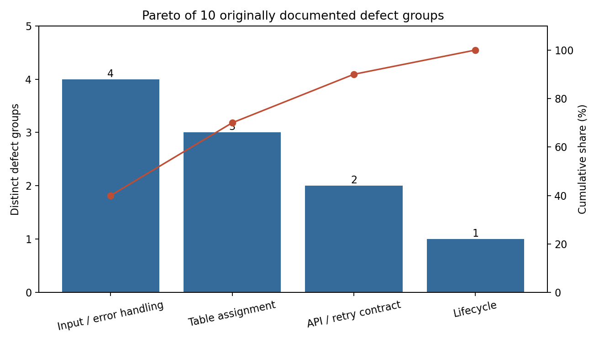

# Reservation defects: analysis and release decision

> **Merged status, 27 November 2026:** PR #32 merged at `055c117f384f92e9c9dc49e8858d6ad52b59b8a5`; the former candidate states in this preserved analysis describe the pre-merge investigation. Issues #21, #23, #24, #25 and #27 are closed for scoped acceptance. Issues #18, #19, #20, #22 and #26 remain open for the residual operational, historical-data, noncooperating-writer or mobile-client limitations described below. Production release remains on hold pending the controls in [the security review](idempotency-security-review.md).

This is an SQE review-branch analysis, not an assertion that changes have reached main. The historical defect evidence and issue descriptions remain intact in [defects.md](defects.md). The user reported team approval for the listed business rules on 27 November; persistence/retention design and integration review remain open. See [final contract decisions](final-contract-decisions.md).

## Defect-group status and risk

| ID / issue | Severity / priority | Current review-branch state and evidence | Residual risk / release impact |
| --- | --- | --- | --- |
| D01 / [#18](https://github.com/fizzaniaz17-arch/kitchen-nasty/issues/18) | High / high | Candidate implemented: optional customer-scoped idempotency keys replay identical requests and reject changed payloads; nine PostgreSQL cases passed. | R-P01; retention, deletion, client adoption and stored-response privacy require team review before release. |
| D02 / [#19](https://github.com/fizzaniaz17-arch/kitchen-nasty/issues/19) | High / high | Partially fixed in [PR #29](https://github.com/fizzaniaz17-arch/kitchen-nasty/pull/29): assignment and effective party-size checks pass PostgreSQL regressions. | R-P03; old associations and later table capacity edits are not remediated. |
| D03 / [#20](https://github.com/fizzaniaz17-arch/kitchen-nasty/issues/20) | High / high | Candidate local fix: transactional locks and 14 PostgreSQL conflict cases; approved old-behavior characterization was replaced with a 409/read-back regression; historical evidence is retained. | R-P01; noncooperating DB writers and historical collisions can bypass/remain; candidate needs integration review. |
| D04 / [#21](https://github.com/fizzaniaz17-arch/kitchen-nasty/issues/21) | High / high | Candidate implemented: 13 disallowed lifecycle regressions and both formerly failing browser exceptions pass under the team-reported matrix. | R-P02; transition code and client behavior require hosted integration and reviewer verification. |
| D05 / [#22](https://github.com/fizzaniaz17-arch/kitchen-nasty/issues/22) | High / high | Partially fixed in PR #29: inactive and wrong-location assignment regressions pass. | R-P03; historic or subsequently deactivated associations are not remediated. |
| D06 / [#23](https://github.com/fizzaniaz17-arch/kitchen-nasty/issues/23) | Medium / high | Fixed for reviewed unknown-table requests in PR #29; controlled 4xx and preserved row. | R-P03; original 1.5-second timeout was local observation, not a proven production timeout. |
| D07 / [#24](https://github.com/fizzaniaz17-arch/kitchen-nasty/issues/24) | Medium / high | Fixed for tested create/update impossible calendar and clock cases in PR #29. | M2-R01 proposed; historic invalid records not automatically corrected. |
| D08 / [#25](https://github.com/fizzaniaz17-arch/kitchen-nasty/issues/25) | Medium / high | Six malformed query regressions pass in [PR #30](https://github.com/fizzaniaz17-arch/kitchen-nasty/pull/30); error forwarding and semantic query dates added. | M2-R02 proposed; team-reported branch sign-off recorded; legacy forms and deployment/time-zone compatibility need review. |
| D09 / [#26](https://github.com/fizzaniaz17-arch/kitchen-nasty/issues/26) | Medium / high | Candidate implemented: optional requested-time fields are added without removing daily slots; the two prior guide cases pass. | R-P05; mobile uses a separate mismatched endpoint and remains outside this batch; integration review required. |
| D10 / [#27](https://github.com/fizzaniaz17-arch/kitchen-nasty/issues/27) | Medium / normal | Fixed for tested malformed encoded ID in PR #29; observed controlled 400. | M2-R02 proposed; other malformed routes not comprehensively proven. |

## Root cause analysis: conflicting assignment (#20)

**Five whys.** (1) Two reservations occupied one table/slot. (2) Both PATCH requests accepted and persisted the assignment. (3) The update checked table eligibility but did not query existing occupants. (4) No database constraint or shared transaction lock enforced slot exclusivity. (5) The status and overlap contract was not fully settled in the tracked issue. The first four points are supported by controller/schema and reproduction; the relationship between unclear requirements and the original omission is a hypothesis, not established history.

**Cause-and-effect / fishbone.** Requirements: occupancy and duration ambiguity. Code: no conflict predicate. Data: no uniqueness/exclusion invariant. Concurrency: independent writes without shared serialization. Tests: historical evidence showed sequential and simultaneous double assignments. Process: the occupancy contract was not finalized during the initial investigation; the user has since reported team approval. Corrective action: exact-slot transaction, sorted locks, status predicate, reactivation check, 409/read-back tests. Preventive action: review every state-changing writer, define explicit invariant and test real DB contention; evaluate a database-enforced constraint only after handling historical conflicts and status semantics.

## Root cause analysis: invalid transitions (#21)

**Five whys.** (1) Invalid lifecycle transitions persisted. (2) PATCH wrote the requested status. (3) Validation checked enum membership but did not compare existing and target status. (4) The lifecycle matrix is described narratively and the code has no transition table. (5) CANCELLED terminal and COMPLETED cancellation behavior were unresolved when the defect was reported; the user has since reported team sign-off. Steps 1-4 are supported by the controller and test evidence; whether ambiguity caused the missing validation is a hypothesis.

**Cause-and-effect / fishbone.** Requirements: incomplete transition decisions. Code: schema-only enum validation. Data: status can persist any accepted enum. Tests: 13 disallowed cases and two browser failures expose the gap. Integration: availability/occupancy depends on status. Corrective action: enforce the reported approved transition table atomically with occupancy checks and test allowed/disallowed transitions with read-back. Preventive action: trace approved business rules to state-transition tests and preserve mismatch evidence.

## Pareto analysis

Count **distinct originally documented defect groups**, not failed test invocations or incident frequency: input/error handling D06/D07/D08/D10 = 4; table assignment D02/D03/D05 = 3; API/retry contract D01/D09 = 2; lifecycle D04 = 1. These categories partition the ten groups once each. The first two categories account for 7/10 groups (70%); this does not imply 70% of incidents or risk. Grouping and the small sample limit the interpretation.

## Measurable release decision: HOLD

Exit criteria: team signs off lifecycle, occupancy, availability, retry and date/timezone contracts; no unexpected API/browser/integration regressions; 100% Member 1 coverage and Stryker at least the unchanged 60% gate; scoped generator checks and execution audit pass; hosted required CI/Sonar checks pass for the actual reviewed integration head; teammates' contributions and secrets are protected; all required approvals and branch protections are satisfied. Current hold: local candidate requires reviewed idempotency persistence/retention, security review, integration on current main, required hosted CI/Sonar and teammate review. Local API and browser results must be rechecked on the integration candidate. Do not close issues or merge merely on a local passing gate.
