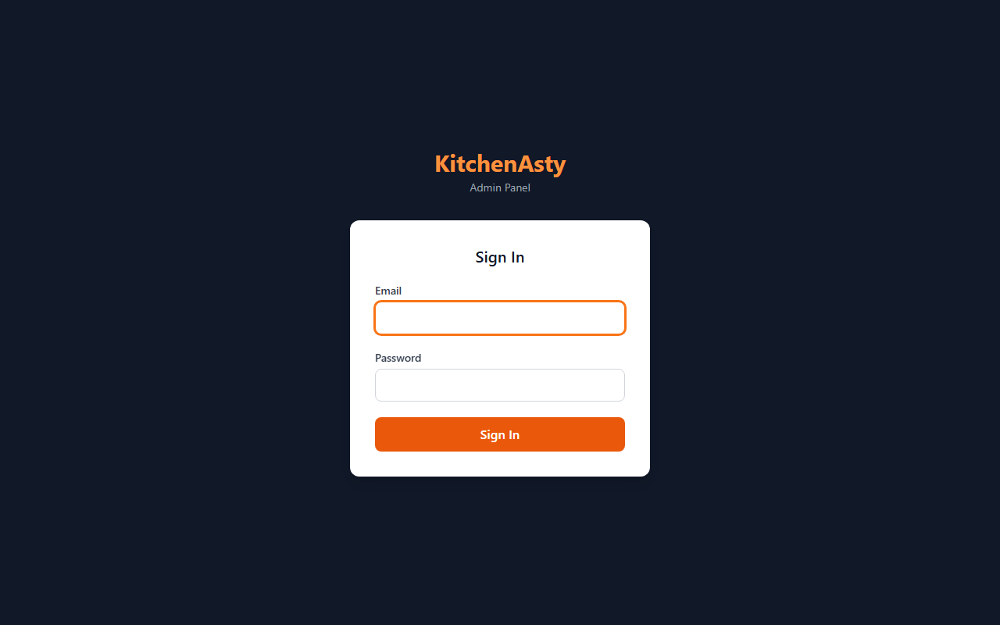
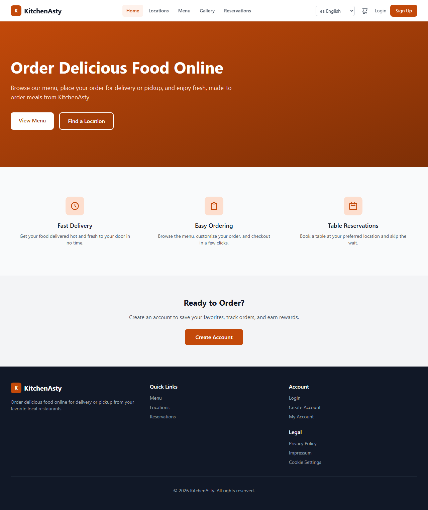
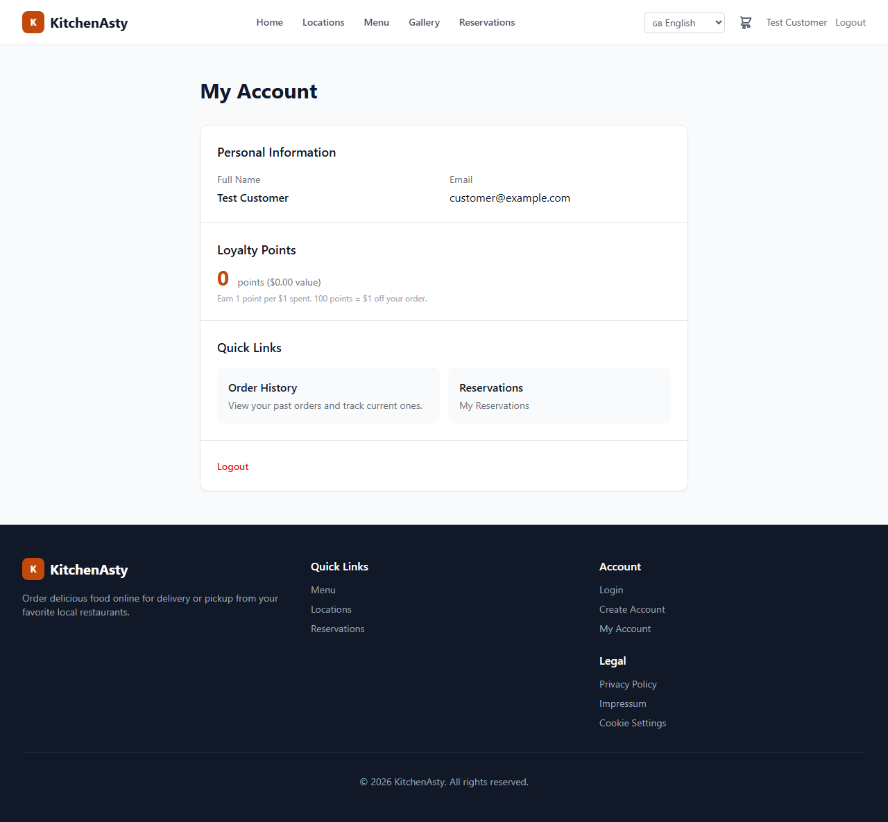

# Student 3 Security Remediation Report

## Scope and outcome

This report covers the security-header findings, social-auth token exposure, and dependency audit for the `hamza` branch of `fizzaniaz17-arch/kitchen-nasty`. No PostgreSQL recovery testing, migrations, seeds, or database changes were performed.

The header and social-auth changes are committed on this branch. PR [#7](https://github.com/fizzaniaz17-arch/kitchen-nasty/pull/7) targets `main` and remains open; it has not been merged. Automated checks and local UI captures below are supporting evidence; they do not represent a production deployment or a post-remediation ZAP rescan.

## Security headers

The admin, storefront, and documentation Nginx configurations set:

| Header | Value |
|---|---|
| `Content-Security-Policy` | `frame-ancestors 'none'` |
| `X-Frame-Options` | `DENY` |
| `X-Content-Type-Options` | `nosniff` |
| `Referrer-Policy` | `no-referrer` |

Admin and storefront Vite development servers return the same four headers. Playwright response-header checks passed for both applications. Local `GET /` responses also returned each header with the values above.

The CSP deliberately limits itself to anti-framing. A full resource allowlist was not added because script, style, image, API, payment, and other external resource sources have not been inventoried. Live Nginx behavior was not verified in a running production container.

## Social authentication

The callback no longer places a JWT in its redirect URL. It returns a short-lived, single-use authorization code, bound to browser OAuth state, and the storefront exchanges that code through `POST /api/auth/social/exchange`. The server validates state, expires codes after 60 seconds, and disables caching/referrer leakage on callback and exchange responses. Caller-controlled mobile redirect selection was removed.

Integration coverage checks code expiry/replay and state-cookie handling. The browser regression confirms the callback exchanges a code, removes it from the visible URL, and reaches the authenticated account screen.

The state and code stores are process-local. Multi-instance deployments need sticky routing for the complete flow or shared storage. Social callbacks currently redirect to the storefront; the mobile app does not yet include a native social-login launcher.

## Validation evidence

| Check | Result |
|---|---|
| Shared and server unit/integration suites (`npm test`) | 420 passed |
| Member 1 coverage gate | 56 passed; 100% statements, branches, functions, and lines |
| Member 1 mutation gate | 64.93%; above the 60% break threshold |
| Focused partial-update regression suites | 121 passed |
| Full server suite used for Sonar LCOV | 459 passed |
| Storefront social-auth regression tests | 5 passed |
| Changed-source coverage in combined server/storefront reports | 130/153 added lines (85.0%) |
| Security-header and social-callback Playwright checks | 3 passed |
| Mobile TypeScript check | Passed |
| Expo public configuration smoke check | Passed |
| iOS and Android Expo bundle exports | Passed |
| Server TypeScript build | Passed |
| Shared, server, admin, and storefront production builds | Passed |
| Documentation build | Passed with VitePress 1.6.4 and Vite 6.4.6 |
| Local admin/storefront response-header inspection | All four expected headers present |

### Sonar coverage follow-up

The previous SonarCloud run reported 2.5% new-code coverage because its newer analysis-scope behavior ignored the repository's `sonar.sources`, `sonar.tests`, and `sonar.test.inclusions` settings, while CI supplied only the Member 1 LCOV report. The analysis consequently treated out-of-scope mobile and E2E/test files as production source.

The workflow now excludes those test and out-of-scope directories without changing the quality-gate threshold. It generates complete server and storefront LCOV reports, normalizes their paths to the repository root, and includes the new controller validation and social-auth callback regression tests. The local combined reports cover 130 of 153 changed source lines (85.0%). The corrected SonarCloud check is pending a PR CI rerun; the previous failed result is not represented as a pass.

The callback screenshot uses stubbed API responses and a synthetic test identity. No real OAuth provider, JWT, or customer data was used. UI screenshots show local development views only.

### Admin sign-in

### Storefront

### Social-auth callback success

## Audit summary

The full audit decreased from 95 findings (6 critical, 50 high, 31 moderate, 8 low) to 22 (0 critical, 1 high, 21 moderate). The production-only audit decreased from 62 (3 critical, 31 high, 26 moderate, 2 low) to 20 (0 critical, 1 high, 19 moderate). The server production workspace has no remaining audit findings.

The remaining high finding is `image-size` in the Expo 52 / Metro 0.81.5 dependency tree. The available fixed `image-size` 2.x API exports `imageSize` as a named function, while Metro 0.81.5 calls the package's CommonJS export directly as a function. It was not forced across this API boundary. A separate Zod 4 regression found by PR CI was fixed by keeping create-time defaults out of partial update schemas; controller regression tests now verify omitted fields are not written. The mobile app also declares the safe `query-string` 9.5.1 dependency needed by Expo Router's Metro bundle after its navigation dependency stopped providing it transitively. Both mobile platform exports now pass. Remaining moderate findings are Expo SDK dependency-chain findings and two Stryker development-tool findings; see the dependency audit report for triage and evidence.

## Evidence and limitations

- Baseline and final npm audit JSON files are in `reports/student-3/security/`.
- The security-header, social-auth, and dependency-audit commits are on `hamza`; PR #7 is open for review and has not been merged.
- No post-remediation ZAP scan or production Nginx container test was run.
- No database recovery work was performed.
