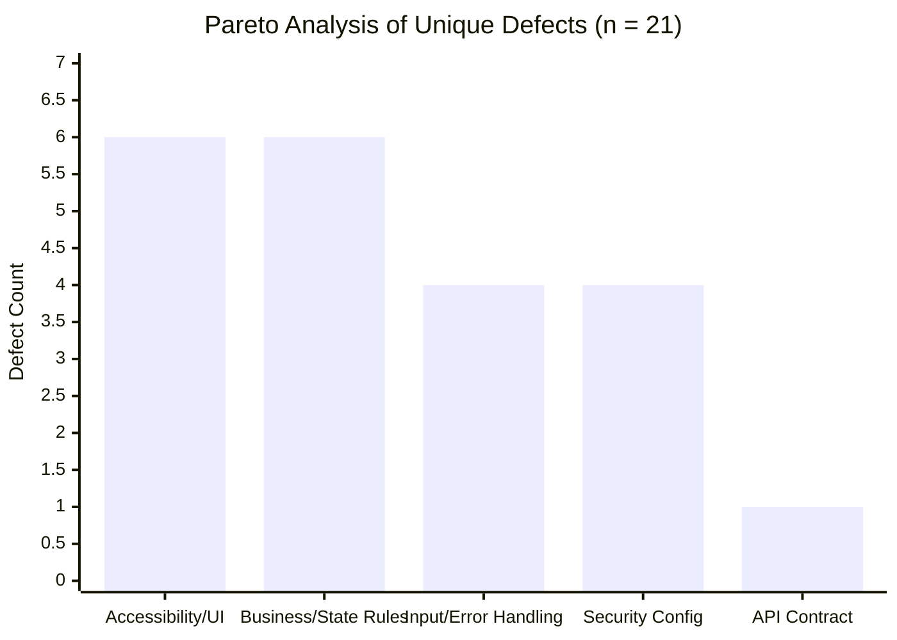

# KitchenAsty — Consolidated Defect Register, Pareto Analysis & Root Cause Analysis

**Scope:** Reservations and Table Management Module (Combined Member 1, Member 2, and Student 3 Findings)  
**Branch:** `integration/final-sqe-submission`  
**Date:** 2026-11-27  

---

## 1. Consolidated Defect Register (Deduplicated)

All defect identifiers from Student 3 (`D-01..D-06`, `D-C01..D-C05`), Member 2 (`M2-D01..M2-D10`), and Member 1 (`PR #8` past-date reservation defect) were inspected and deduplicated.

> **Deduplication Note:** Student 3's `D-05` ("No transition state validation on reservation status") and Member 2's `M2-D04` ("`PATCH /api/reservations/:id` accepts all 13 disallowed lifecycle transitions") describe the **same underlying defect** and are merged into a single unique entry (`D-05 / M2-D04`) to avoid double-counting.

| Unique ID | Source IDs | Category | Component | Severity | Status | Risk Link | Evidence |
|---|---|---|---|---|---|---|---|
| **DEF-01** | `M1-PAST-DATE` (PR #8) | Business-Rule Validation | `reservation.controller.ts` (`createReservation`) | High | Fixed in PR #8 (open, unmerged to `main`) | `R-P04` | `docs/sqe/member-1/quality-report.md`, `pr8-member1-green-03d977c.png` |
| **DEF-02** | `M2-D01` (Issue #18) | Business-Rule Validation | `POST /api/reservations` (retry/idempotency) | High | Open | `R-P01` | `docs/sqe/member-2/defects.md` (1 failing test) |
| **DEF-03** | `M2-D02` (Issue #19) | Business-Rule Validation | `PATCH /api/reservations/:id` (table capacity) | High | Open | `R-P03` | `docs/sqe/member-2/defects.md` (1 failing test) |
| **DEF-04** | `M2-D03` (Issue #20) | Business-Rule Validation | `PATCH /api/reservations/:id` (slot double-booking) | High | Open | `R-P01` | `docs/sqe/member-2/defects.md` (1 failing test) |
| **DEF-05** | `D-05` / `M2-D04` (Issue #21) | State-Transition Validation | `PATCH /api/reservations/:id` (lifecycle matrix) | High | Open | `R-P02` | `docs/sqe/member-2/defects.md` (13 failing tests), `test-completion-report.md` |
| **DEF-06** | `M2-D05` (Issue #22) | Business-Rule Validation | `PATCH /api/reservations/:id` (inactive/other-location table) | High | Open | `R-P03` | `docs/sqe/member-2/defects.md` (2 failing tests) |
| **DEF-07** | `M2-D06` (Issue #23) | Input Validation & Error Handling | `PATCH /api/reservations/:id` (unknown `tableId` FK hang) | Medium | Open | `R-P03` | `docs/sqe/member-2/defects.md` (1 failing test) |
| **DEF-08** | `M2-D07` (Issue #24) | Input Validation & Error Handling | `POST`/`PATCH /api/reservations` (impossible date/clock) | Medium | Open | `M2-R01` | `docs/sqe/member-2/defects.md` (8 failing tests) |
| **DEF-09** | `M2-D08` (Issue #25) | Input Validation & Error Handling | `GET /api/reservations[/availability]` (malformed filter hang) | Medium | Open | `M2-R02` | `docs/sqe/member-2/defects.md` (6 failing tests) |
| **DEF-10** | `M2-D09` (Issue #26) | API Contract Discrepancy | `GET /api/reservations/availability` (`time` query ignored) | Medium | Open | `R-P05` | `docs/sqe/member-2/defects.md` (2 failing tests) |
| **DEF-11** | `M2-D10` (Issue #27) | Input Validation & Error Handling | `GET /api/reservations/:id` (malformed `%ZZ` returns 500) | Medium | Open | `M2-R02` | `docs/sqe/member-2/defects.md` (1 failing test) |
| **DEF-12** | `D-01` | Security Configuration | Server/Nginx (missing CSP header) | Medium | Open | — | `reports/student-3/security/zap-passive.json` |
| **DEF-13** | `D-02` | Security Configuration | Server/Nginx (missing `X-Frame-Options` header) | Medium | Open | — | `reports/student-3/security/zap-passive.json` |
| **DEF-14** | `D-03` | Security Configuration | Server/Nginx (missing `X-Content-Type-Options` header) | Low | Open | — | `reports/student-3/security/zap-passive.json` |
| **DEF-15** | `D-04` | Security Configuration | Social auth controller (JWT in URL query) | Medium | Open | — | `reports/student-3/security/security-controls-review.md` |
| **DEF-16** | `D-06` | Accessibility & UI | Storefront template color contrast | Moderate | Open | — | `reports/student-3/usability-accessibility/accessibility-findings.md` |
| **DEF-17** | `D-C01` | Accessibility & UI | Customer reservation form missing `htmlFor`/`id` labels | Critical | Closed | — | `reports/student-3/accessibility/reservation-after.json` |
| **DEF-18** | `D-C02` | Accessibility & UI | Admin layout invalid navigation landmark | Minor | Closed | — | `reports/student-3/accessibility/admin-reservation-list.json` |
| **DEF-19** | `D-C03` | Accessibility & UI | Admin reservation list contrast failures | Serious | Closed | — | `reports/student-3/accessibility/admin-reservation-list.json` |
| **DEF-20** | `D-C04` | Accessibility & UI | Admin menu button accessible-name mismatch | Serious | Closed | — | `reports/student-3/accessibility/admin-reservation-list.json` |
| **DEF-21** | `D-C05` | Accessibility & UI | Admin badge calling non-existent `/api/dashboard` route | Medium | Closed | — | `packages/admin/src/components/AdminLayout.tsx` |

**Total Unique Defects:** **21** (15 Open, 5 Closed, 1 Fixed in unmerged PR #8).

---

## 2. Pareto Analysis

Grouping the 21 unique defects by root-cause category:

| Category | Defect IDs | Count | % of Total | Cumulative % |
|---|---|---:|---:|---:|
| **Accessibility & UI** | DEF-16, DEF-17, DEF-18, DEF-19, DEF-20, DEF-21 | 6 | 28.6% | 28.6% |
| **Business-Rule & State Validation** | DEF-01, DEF-02, DEF-03, DEF-04, DEF-05, DEF-06 | 6 | 28.6% | 57.1% |
| **Input Validation & Error Handling** | DEF-07, DEF-08, DEF-09, DEF-11 | 4 | 19.0% | 76.2% |
| **Security Configuration** | DEF-12, DEF-13, DEF-14, DEF-15 | 4 | 19.0% | 95.2% |
| **API Contract Discrepancy** | DEF-10 | 1 | 4.8% | 100.0% |
| **Total** | | **21** | **100.0%** | **100.0%** |

### Pareto Chart (ASCII & Mermaid)

```text
Accessibility & UI               | ██████ (6)  28.6%  [Cum: 28.6%]
Business-Rule & State Validation | ██████ (6)  28.6%  [Cum: 57.1%]
Input Validation & Error Handling| ████   (4)  19.0%  [Cum: 76.2%]
Security Configuration           | ████   (4)  19.0%  [Cum: 95.2%]
API Contract Discrepancy         | █      (1)   4.8%  [Cum: 100.0%]
```



**Interpretation (80/20 Insight):**  
Three categories — **Accessibility & UI (28.6%)**, **Business-Rule & State Validation (28.6%)**, and **Input Validation & Error Handling (19.0%)** — account for **76.2% (16 of 21)** of all unique defects. Furthermore, Business-Rule & Input/Error defects together explain **34 of the 36** failing Member 2 API tests (`94.4%` of API test failures).

---

## 3. Root Cause Analysis (RCA)

### RCA Case 1: Missing Lifecycle & Table-Assignment Validation (`DEF-03`, `DEF-04`, `DEF-05`, `DEF-06` / `M2-D02..D05`, `D-05`)

#### Five Whys
1. **Why** did `PATCH /api/reservations/:id` return HTTP `200` for invalid status transitions (`COMPLETED -> PENDING`), undersized tables, inactive/wrong-location tables, and double-booked slots?  
   → Because `updateReservation` directly builds a Prisma `data` object from Zod-parsed fields and executes `prisma.reservation.update()`.
2. **Why** did Zod validation not reject these requests?  
   → Because Zod only checks primitive types and enum membership (`ReservationStatus`), not cross-record invariants or state-machine transitions.
3. **Why** were cross-record and state-machine checks omitted from the controller?  
   → Because the initial MVP controller implemented CRUD updates without a domain service layer or transition map.
4. **Why** did earlier integration tests not catch these omissions?  
   → Because existing integration tests (`reservation.test.ts`) only tested valid happy-path updates and ownership checks, not negative lifecycle matrices or capacity/conflict boundaries.
5. **Why** was there no requirement-to-test gate for these rules before SQE testing?  
   → Because API documentation (`packages/docs/features/reservations.md`) was not paired with executable OpenAPI/EP-BVA contract tests during feature development.

#### Fishbone (Ishikawa) Summary
- **Code / Design:** No domain state-transition map; no Prisma transaction checking table capacity, `isActive`, `locationId`, or overlapping non-cancelled bookings.
- **Specifications:** Prose docs (`reservations.md`) drifted from controller implementation.
- **Testing:** Early unit/integration suites lacked negative boundary & state-matrix coverage.
- **Process:** Feature PRs were merged without automated EP/BVA or lifecycle-matrix gates.

**Corrective Actions:** Implement a transition map in `updateReservation`, validate table ownership/active status/capacity and slot conflicts inside a transaction, and re-run `vitest.member2.config.ts`.  
**Preventive Actions:** Enforce OpenAPI + EP/BVA generated tests (`tests/team/member-2/`) in CI for all reservation/table PRs.  
**Risk Register Links:** `R-P01`, `R-P02`, `R-P03`.

---

### RCA Case 2: Customer Reservation Form Missing Label Associations (`DEF-17` / `D-C01`)

#### Five Whys
1. **Why** did axe-core report 2 critical/serious violations (`label`, `select-name`) and Lighthouse score `0.88` on `/reservations`?  
   → Because `<label>` elements in `packages/storefront/src/pages/Reservations.tsx` lacked `htmlFor` attributes and form controls lacked matching `id` attributes.
2. **Why** did the developer omit `htmlFor`/`id` pairs?  
   → Because visual styling relied on Tailwind layout wrappers (`<div><label>...</label><select>...</select></div>`), which look identical to sighted mouse users without programmatic association.
3. **Why** was this not caught during functional E2E testing?  
   → Because earlier Playwright tests located inputs via CSS selectors (`form select`, `textarea`) rather than accessible role/label queries (`getByLabel`).
4. **Why** did CI not flag the accessibility regression?  
   → Because `@axe-core/playwright` and Lighthouse audits were not part of the storefront CI pipeline.

#### Fishbone (Ishikawa) Summary
- **Code:** Unassociated `<label>` and `<select>`/`<input>` elements in React JSX.
- **Testing:** Selectors bypassed accessibility tree (`locator('select')` instead of `getByLabel()`).
- **Tooling:** No automated axe-core check in CI prior to Student 3's evaluation.

**Corrective Action (Completed):** Added `htmlFor` and stable `id` attributes (`reservation-location`, `reservation-date`, `reservation-party-size`, `reservation-comment`) in `Reservations.tsx`; verified axe-core `2 -> 0` violations and Lighthouse `0.88 -> 1.00`.  
**Preventive Action:** Retain `e2e/student-3/accessibility.spec.ts` and `usability-keyboard.spec.ts` in the `student-3` Playwright suite.
